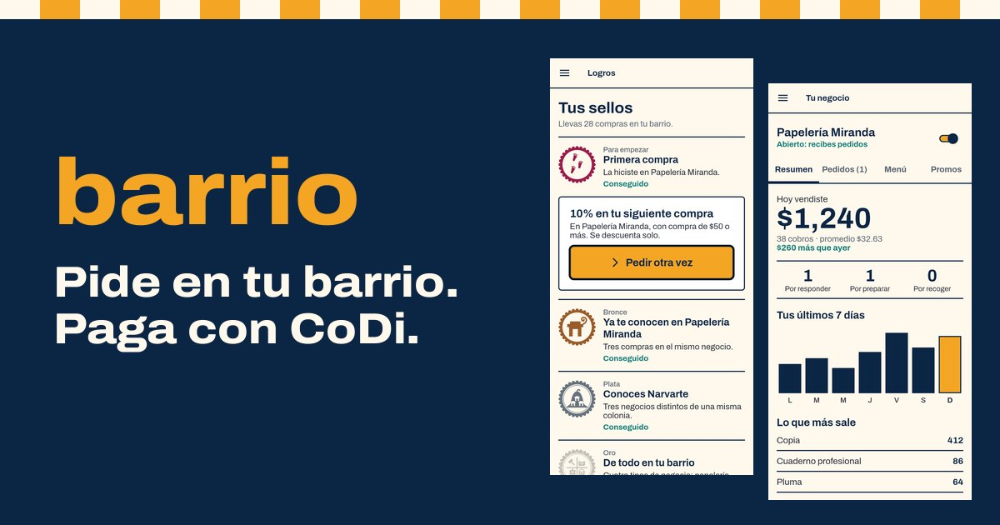
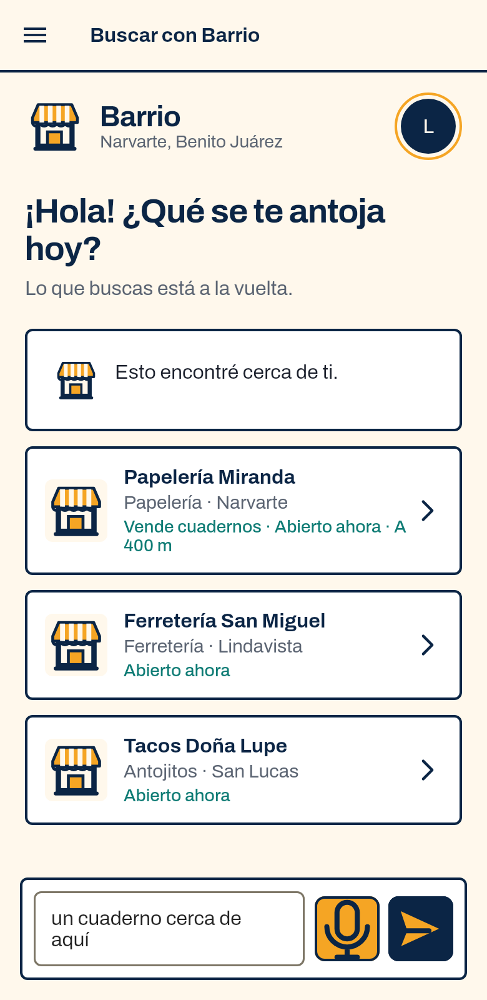
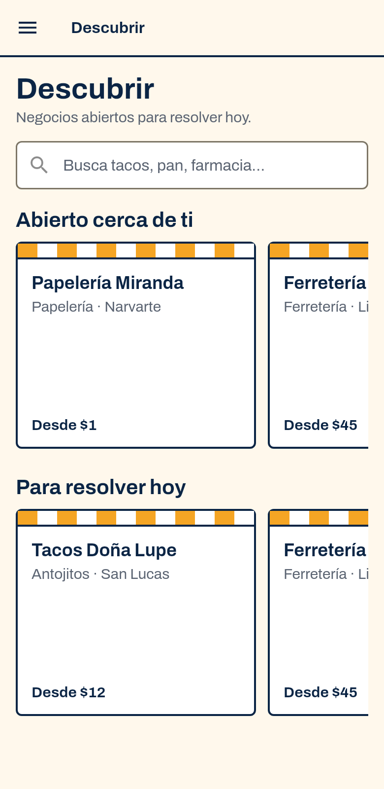
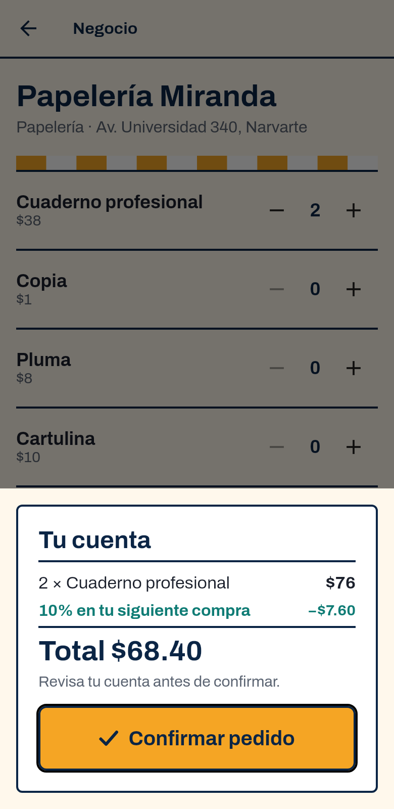
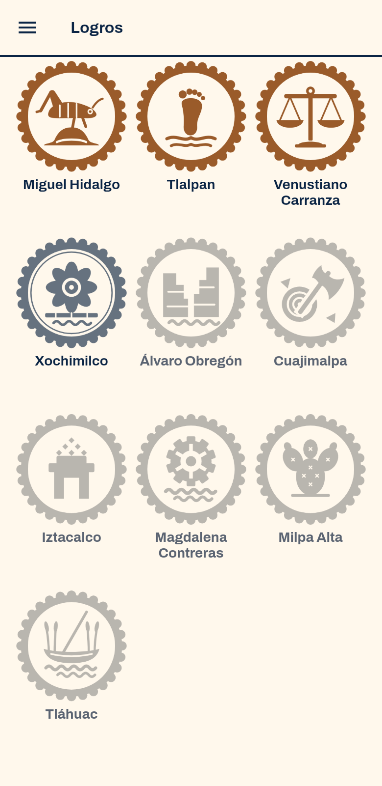
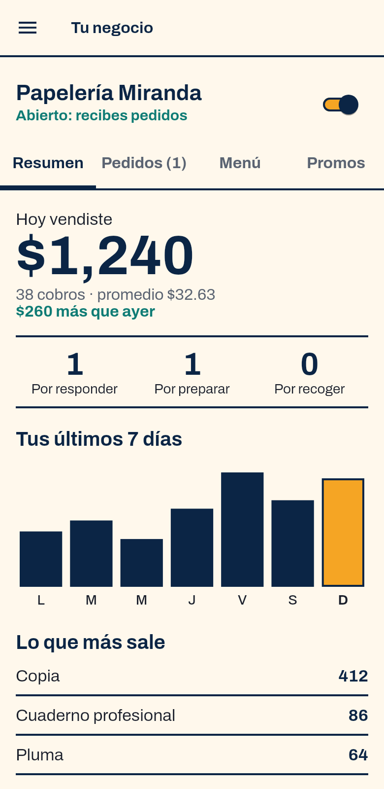
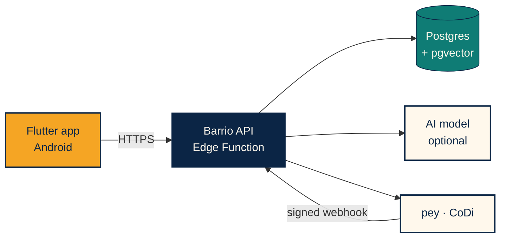

<div align="center">



[Español](README.md) · **English**

# barrio

### the best of the neighborhood, one tap away

**Search your neighborhood in your own words, see the total before ordering and pay with CoDi from your banking app.**

   

[Website](https://jade-paprenjak-a98b06.netlify.app) · [Download for Android](https://jade-paprenjak-a98b06.netlify.app/descargar/) · [Pitch](docs/PITCH.en.md) · [Submission dossier](docs/ENTREGA.en.md) · [Screens](docs/capturas/README.md)

`DevDay Exchange Community Hackathon · Mexico City · Nov 7–8, 2026`

</div>

> Barrio is built for Mexico City, so the app and website are in Spanish. **CoDi** is Banco de México's digital collection system: a payment request reaches your banking app and you approve it there.

---

## The essentials in 30 seconds

Neighborhood shops live on cash and are almost impossible to find online. Barrio combines three things: natural-language search over a real catalog, an order whose total is always calculated by the server, and a CoDi charge pushed straight to the banking app.

**The API, the model and the payments run in production; the catalog shops are demo data.** On November 8, 2026 a real payment was completed end to end: order created, accepted, a MX$0.01 CoDi charge approved in the banking app, and the order marked as paid by pey's signed webhook.

| Buyer | Barrio | Bank |
|---|---|---|
| Asks in their own words or by voice | Interprets, searches the catalog and asks if something is missing | |
| Confirms the total | Calculates the total from the current menu | |
| | The shop accepts and the charge goes out through pey | CoDi charge arrives |
| Gets a pickup code | Signed webhook: order paid | Approves |

## Try it in 5 minutes

You need an Android phone and a mobile number with **CoDi active** at a Mexican bank.

1. Install the APK from the [download page](https://jade-paprenjak-a98b06.netlify.app/descargar/) and allow installs from that source. Barrio exists only as an Android app.
2. Create an account with your email and accept the notifications permission.
3. Enter your 10-digit mobile number and your borough.
4. In **Buscar con Barrio**, type `algo para una fiesta` ("something for a party"). Barrio answers with options and asks you a question; tap an answer and keep the conversation going.
5. Open **Tacos Doña Lupe**, add the **Taco de prueba** and confirm the MX$0.01 order.
6. In about 5 seconds the shop accepts automatically and the charge reaches you. Approve it in your bank.
7. The app shows **¡Pagado!** ("Paid!") with your pickup code.

> **This is real money:** the cent is actually charged and is not refunded. That is why the test item costs MX$0.01, as the organizers requested.
>
> **To try another account on the same phone,** clear the app's data or reinstall it. See [limits](#what-is-real-and-what-is-demo).

To see the shop side, open the side menu and go to **Tu negocio**: sign-up, menu, orders, promotions and sales summary.

## For the judges

| Criterion | What to look at | Where |
|---|---|---|
| **Useful AI with limits** | The model turns free text into typed filters using a strict JSON schema. Search combines exact rules and vectors. The model can only pick shops retrieved from the catalog. | [`agent.js`](backend/src/agent.js), [`search.js`](backend/src/search.js) |
| **Real conversation** | Bounded history, follow-up questions drawn from actual results, at most 3 per conversation and never repeated. The server drops areas nobody asked for. | [`agent.js`](backend/src/agent.js), [`chat_screen.dart`](barrio_app_pey/lib/components/sections/chat_screen.dart) |
| **pey integration** | CoDi push, Standard Webhooks signature, idempotency, amount check and fallback lookup. | [`pagos.js`](backend/src/pagos.js) |
| **Money handled carefully** | The total comes from the server, quotes expire, explicit confirmation, one active charge per order and state changes conditional on the previous state. | [`pedidos.js`](backend/src/pedidos.js), [`rutas.js`](backend/src/rutas.js) |
| **Local impact** | Android, Mexican Spanish, short steps, a shop dashboard and badges for all 16 boroughs. | [Screens](docs/capturas/README.md), [Badges](docs/LOGROS.md) |

**AI never decides prices, availability or totals.** If the model is unavailable, search keeps working with exact rules. Whatever a person types is treated as data, never as instructions.

## The app

<table>
<tr><th>Search</th><th>Discover</th><th>Order</th><th>Badges</th><th>Shop dashboard</th></tr>
<tr>
<td></td>
<td></td>
<td></td>
<td></td>
<td></td>
</tr>
</table>

These screenshots use sample data. Here are [all the screens](docs/capturas/README.md).

## What is real and what is demo

We would rather say it plainly.

| Real, in production | Demo or pending |
|---|---|
| API on Supabase Edge Functions and Postgres database | **Where the money goes:** charges land in a pre-authorized test account set up for the hackathon. Registering each shop's account with Banxico takes about 5 business days |
| Model and semantic search with pgvector (`meta.mode: agent_rag`) | **Auto-accept:** Doña Lupe accepts the test taco after 5 s, so it can be tried without a second phone |
| CoDi push charge and signed pey webhook | **Alerts:** local notifications while Android keeps the app alive; no push with the app closed yet |
| Shop sign-up without manual review, with menu and promotions | **APK:** signed with a debug key, not on Google Play |
| | **Accounts:** no password recovery or account deletion; signing out does not clear local profile data |
| | **Legal and usage:** privacy notice, terms and search rate limiting are still missing |

The full list is in [`pendientes/`](pendientes/README.md) (Spanish).

## Architecture



The app never touches database tables and holds no server keys. The API validates permissions, calculates totals, controls order states and is the only component that talks to pey and the model. More diagrams are in the [submission dossier](docs/ENTREGA.en.md).

```text
pendiente → aceptada → cobrada → pagada → lista → entregada
pending     accepted   charged   paid     ready   delivered
```

Each transition requires the previous state, so a retry or a race cannot advance an order twice.

## Quality

| Check | Covers |
|---|---|
| `backend`: `npm run check` and `npm test` (24 tests) | Money, states, webhook signature, search and conversation |
| `barrio_app_pey`: `flutter analyze` and `flutter test` (8 tests) | Sign-up, profile, dashboard, badges, money and alerts. Run manually |
| `supabase/tests/schema_smoke.sql` | Migrations and permissions on Postgres with pgvector |
| `backend/scripts/e2e-live.mjs` | Full journey against the real database, with pey mocked |

CI runs the `backend`, `supabase` and `web` jobs on every PR. The flow is `feature/*` → `dev` → `stg` → `main`.

## Structure

| Path | Purpose |
|---|---|
| [`barrio_app_pey/`](barrio_app_pey) | Flutter app: buying, shop management, voice input and alerts |
| [`backend/`](backend) | API: orders, payments, search and conversation |
| [`supabase/`](supabase) | Migrations, demo data and schema tests |
| [`web/`](web) | Landing page, blog and download page. `app.html` is a prototype that is no longer linked |
| [`docs/`](docs) | Pitch, submission dossier, product, API, pey, design and brand voice |
| [`pendientes/`](pendientes/README.md) | What is missing, unvarnished |

## Run it locally

```bash
# API: requires backend/.env based on .env.example
cd backend && npm run check && npm test && npm start

# App
cd barrio_app_pey && flutter pub get && flutter analyze && flutter run

# Schema
bash supabase/tests/run.sh
```

Secrets live only on the backend or in the Edge Function secrets. To deploy the API: `cd backend && npm run build:edge`.

---

<div align="center"><sub>Made in Mexico City so neighborhood shops can sell further without losing their closeness.</sub></div>
