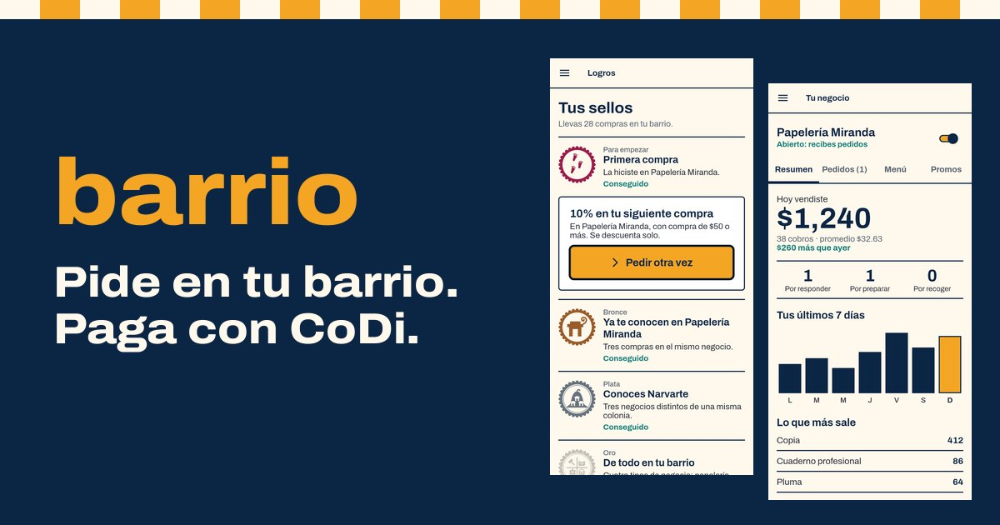
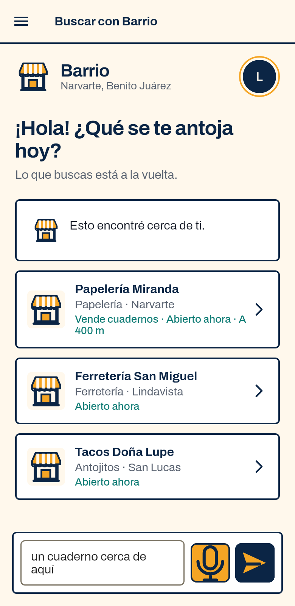
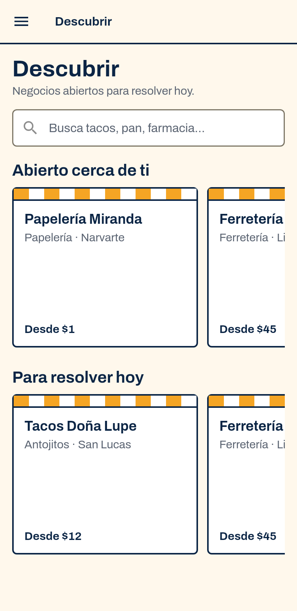
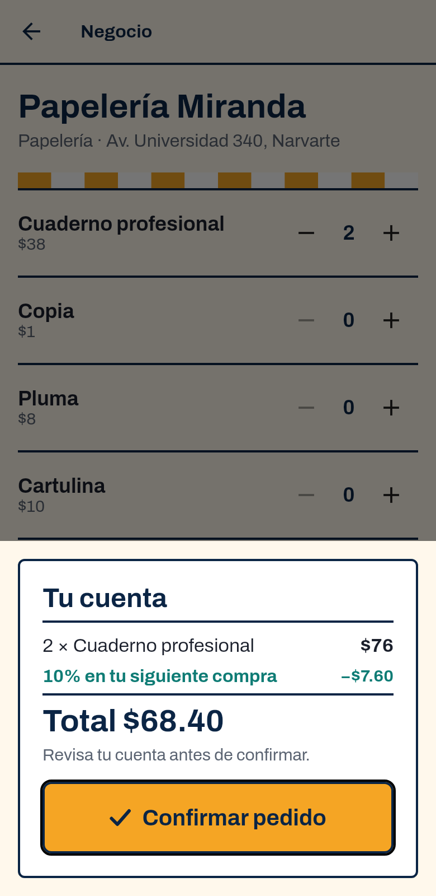
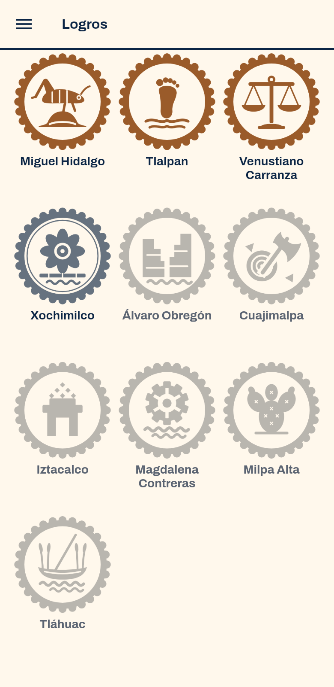
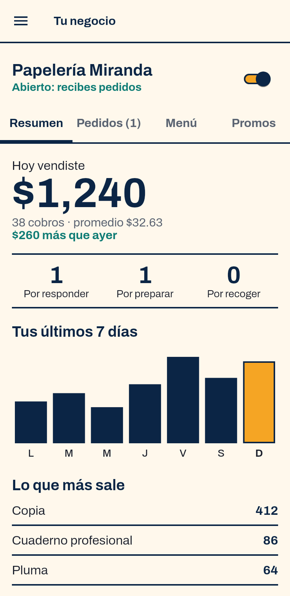
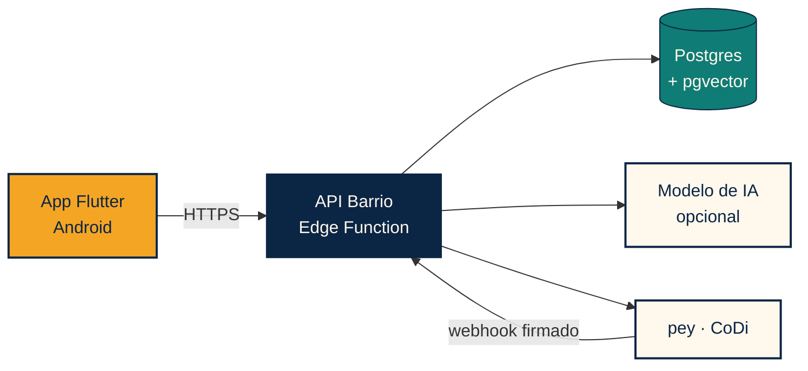

<div align="center">



**Español** · [English](README.en.md)

# barrio

### lo bueno del barrio, a un toque

**Busca en tu barrio con tus palabras, ve el total antes de pedir y paga con CoDi desde la app de tu banco.**

   

[Sitio](https://jade-paprenjak-a98b06.netlify.app) · [Descargar para Android](https://jade-paprenjak-a98b06.netlify.app/descargar/) · [Pitch](docs/PITCH.md) · [Expediente de entrega](docs/ENTREGA.md) · [Pantallas](docs/capturas/README.md)

`DevDay Exchange Community Hackathon · CDMX · 7–8 nov 2026`

</div>

---

## Lo importante en 30 segundos

El comercio de barrio vive del efectivo y casi nadie lo encuentra en línea. Barrio une tres cosas: una búsqueda en lenguaje natural sobre un catálogo real, un pedido cuyo total calcula siempre el servidor, y un cobro CoDi que llega por push a la app del banco.

**La API, el modelo y los cobros corren en producción; los negocios del catálogo son de demo.** El 8 de noviembre de 2026 se completó un pago real de punta a punta: pedido creado, aceptado, cobro CoDi de $0.01 aprobado en la app del banco y pedido marcado como pagado por el webhook firmado de pey.

| Comprador | Barrio | Banco |
|---|---|---|
| Pide con sus palabras o dictando | Interpreta, busca en el catálogo y pregunta si falta algo | |
| Confirma el total | Calcula el total desde el menú vigente | |
| | El negocio acepta y se envía el cobro por pey | Llega el cobro CoDi |
| Recibe su código para recoger | Webhook firmado: pedido pagado | Aprueba |

## Pruébalo en 5 minutos

Necesitas un teléfono Android y un celular con **CoDi activo** en la app de tu banco.

1. Instala el APK desde [la página de descarga](https://jade-paprenjak-a98b06.netlify.app/descargar/) y permite instalar desde esa fuente. Barrio solo existe como app Android.
2. Crea una cuenta con tu correo y acepta el permiso de notificaciones.
3. Escribe tu celular de 10 dígitos y tu alcaldía.
4. En **Buscar con Barrio**, escribe `algo para una fiesta`. Barrio responde con opciones y te hace una pregunta; toca una respuesta y sigue la conversación.
5. Abre **Tacos Doña Lupe**, agrega el **Taco de prueba** y confirma la cuenta de $0.01.
6. En unos 5 segundos el negocio acepta solo y te llega el cobro. Apruébalo en tu banco.
7. La app muestra **¡Pagado!** con tu código para recoger.

> **Es dinero real:** el centavo se cobra de verdad y no se devuelve. Por eso el producto de prueba cuesta $0.01, como pidieron los organizadores.
>
> **Para probar con otra cuenta en el mismo teléfono**, borra los datos de la app o reinstálala. Ver [límites](#qué-es-real-y-qué-es-de-demo).

Para ver el lado del negocio, abre el menú lateral y entra a **Tu negocio**: alta, menú, pedidos, promociones y resumen de ventas.

## Para quienes evalúan

| Criterio | Qué mirar | Dónde |
|---|---|---|
| **IA útil y con límites** | El modelo convierte lenguaje libre en filtros tipados con esquema JSON estricto. La búsqueda combina reglas exactas y vectores. El modelo solo puede elegir negocios recuperados del catálogo. | [`agent.js`](backend/src/agent.js), [`search.js`](backend/src/search.js) |
| **Conversación real** | Historial acotado, preguntas de seguimiento sacadas de los resultados reales, máximo 3 por conversación y sin repetir. El servidor descarta zonas que nadie pidió. | [`agent.js`](backend/src/agent.js), [`chat_screen.dart`](barrio_app_pey/lib/components/sections/chat_screen.dart) |
| **Integración con pey** | CoDi por push, webhook con firma Standard Webhooks, idempotencia, comprobación de monto y consulta de respaldo. | [`pagos.js`](backend/src/pagos.js) |
| **Dinero bien cuidado** | El total nace en el servidor, cotización con vencimiento, confirmación explícita, un solo cobro vigente por pedido y cambios de estado condicionados al estado anterior. | [`pedidos.js`](backend/src/pedidos.js), [`rutas.js`](backend/src/rutas.js) |
| **Impacto local** | Android, español de México, pasos cortos, panel para el negocio y sellos por las 16 alcaldías. | [Pantallas](docs/capturas/), [Sellos](docs/LOGROS.md) |

**La IA nunca decide precios, disponibilidad ni totales.** Si el modelo no está disponible, la búsqueda sigue funcionando con reglas exactas. Lo que escribe una persona se trata como dato, nunca como instrucción.

## La app

<table>
<tr><th>Buscar</th><th>Descubrir</th><th>Cuenta</th><th>Sellos</th><th>Panel del negocio</th></tr>
<tr>
<td></td>
<td></td>
<td></td>
<td></td>
<td></td>
</tr>
</table>

Estas capturas usan datos de muestra. Aquí están [todas las pantallas](docs/capturas/README.md).

## Qué es real y qué es de demo

Preferimos decirlo claro.

| Real, en producción | De demo o pendiente |
|---|---|
| API en Supabase Edge Functions y base Postgres | **Destino del dinero:** los cobros caen en una cuenta de prueba preautorizada para el hackathon. Registrar la cuenta de cada negocio ante Banxico tarda unos 5 días hábiles |
| Modelo y búsqueda semántica con pgvector (`meta.mode: agent_rag`) | **Auto-aceptado:** Doña Lupe acepta sola el Taco de prueba a los 5 s para poder probar sin un segundo teléfono |
| Cobro CoDi por push y webhook firmado de pey | **Avisos:** notificaciones locales mientras Android mantenga viva la app; aún no hay push con la app cerrada |
| Registro de negocios sin verificación manual, con su menú y promociones | **APK:** firmado con llave de depuración, fuera de Google Play |
| | **Cuentas:** no hay recuperación de contraseña ni borrado de cuenta; al salir no se limpian los datos locales del perfil |
| | **Legal y uso:** faltan aviso de privacidad y términos, y un límite de uso en la búsqueda |

La lista completa está en [`pendientes/`](pendientes/README.md).

## Arquitectura



La app no toca tablas ni contiene llaves de servidor. La API valida permisos, calcula los totales, controla los estados del pedido y es la única que habla con pey y con el modelo.

```text
pendiente → aceptada → cobrada → pagada → lista → entregada
```

Cada transición exige el estado anterior, así que un reintento o una carrera no pueden avanzar un pedido dos veces.

## Calidad

| Comprobación | Cubre |
|---|---|
| `backend`: `npm run check` y `npm test` (24 pruebas) | Dinero, estados, firma del webhook, búsqueda y conversación |
| `barrio_app_pey`: `flutter analyze` y `flutter test` (8 pruebas) | Alta, perfil, panel, sellos, dinero y avisos. Se corre a mano |
| `supabase/tests/schema_smoke.sql` | Migraciones y permisos en Postgres con pgvector |
| `backend/scripts/e2e-live.mjs` | Recorrido completo contra la base real, con pey simulado |

El CI corre los trabajos `backend`, `supabase` y `web` en cada PR. El flujo es `feature/*` → `dev` → `stg` → `main`.

## Estructura

| Ruta | Propósito |
|---|---|
| [`barrio_app_pey/`](barrio_app_pey) | App Flutter: compra, gestión del negocio, dictado y avisos |
| [`backend/`](backend) | API: pedidos, pagos, búsqueda y conversación |
| [`supabase/`](supabase) | Migraciones, datos de demo y pruebas del esquema |
| [`web/`](web) | Landing, blog y página de descarga. `app.html` es un prototipo que ya no se enlaza |
| [`docs/`](docs) | Pitch, guía de entrega, producto, API, pey, diseño y voz de marca |
| [`pendientes/`](pendientes/README.md) | Lo que falta, sin adornos |

## Correrlo localmente

```bash
# API: requiere backend/.env basado en .env.example
cd backend && npm run check && npm test && npm start

# App
cd barrio_app_pey && flutter pub get && flutter analyze && flutter run

# Esquema
bash supabase/tests/run.sh
```

Los secretos viven solo en el backend o en los secretos de la Edge Function. Para desplegar la API: `cd backend && npm run build:edge`.

---

<div align="center"><sub>Hecho en CDMX para que el comercio de barrio venda más lejos sin dejar de sentirse cerca.</sub></div>
