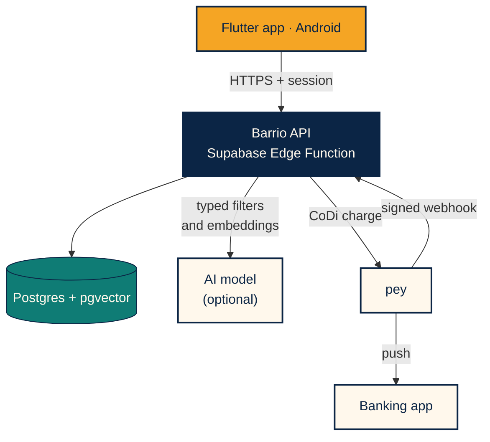
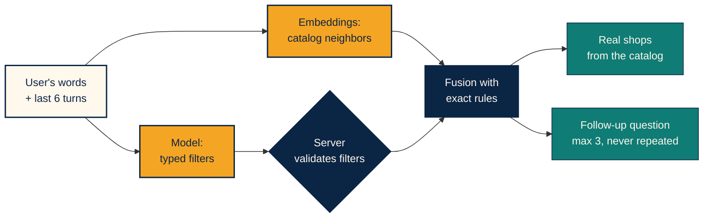
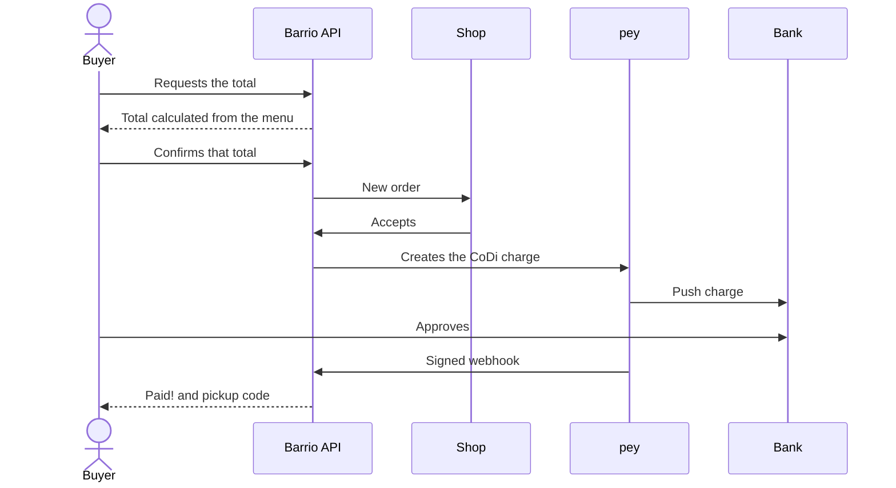
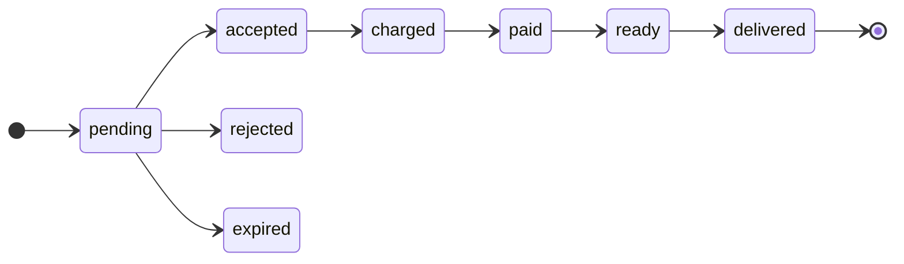

[Español](ENTREGA.md) · **English**

# Barrio · Submission dossier

**DevDay Exchange Community Hackathon · Mexico City · November 7–8, 2026**

AI search over a real catalog, server-calculated totals and real CoDi payments through pey.

   

---

## Links

| | |
|---|---|
| **Website** (Spanish) | https://jade-paprenjak-a98b06.netlify.app |
| **Android app** | [Download page](https://jade-paprenjak-a98b06.netlify.app/descargar/) |
| **Repository** | https://github.com/gpancardo/proyectoCoDi |
| **Pitch** | [`PITCH.en.md`](PITCH.en.md) |
| **Screens** | [All 23 app screens](capturas/README.md) |
<!-- | **Demo video** | LINK | -->
<!-- | **Pitch video** | LINK | -->

## Try it in 5 minutes

You need an Android phone and a mobile number with CoDi active at a Mexican bank. The app is in Spanish.

| Step | What to do |
|:---:|---|
| 1 | Install the APK and allow installs from that source |
| 2 | Create an account with your email and accept notifications |
| 3 | Enter your 10-digit mobile number and your borough |
| 4 | In **Buscar con Barrio**, type `algo para una fiesta` ("something for a party") and answer the question |
| 5 | Open **Tacos Doña Lupe**, add the **Taco de prueba** and confirm MX$0.01 |
| 6 | In about 5 seconds the charge arrives: approve it in your bank |
| 7 | See **¡Pagado!** ("Paid!") and your pickup code |

> The cent is real money and is not refunded. To try another account on the same phone, clear the app's data first.

## Evidence of the real payment

| Time (UTC, Nov 8, 2026) | Event |
|---|---|
| 17:20:08 | Order 21 is created for a MX$0.01 test taco |
| 17:20:13 | The demo accepts the order and pey sends the CoDi push charge |
| 17:20:40 | The bank confirms, the signed webhook arrives and the order becomes `pagada` (paid) |

**32 seconds** from order to payment, with no manual step on the server.

<!-- Real screenshots: add the images from docs/capturas/reales/ here

  
  
  

-->

## What to look at, by judge

| Judge | What we show | Where to see it |
|---|---|---|
| **pey** | End-to-end CoDi push, signed webhook, idempotency, amount check and fallback lookup | [`pagos.js`](../backend/src/pagos.js) |
| **OpenAI** | Strict JSON schema outputs, embeddings and selection limited to the retrieved catalog | [`agent.js`](../backend/src/agent.js) |
| **AI Builders** | Hybrid search, conversation with bounded memory and a no-model fallback | [`search.js`](../backend/src/search.js), [`chat_screen.dart`](../barrio_app_pey/lib/components/sections/chat_screen.dart) |
| **SEDECO** | A tool in Mexican Spanish that helps local commerce sell digitally | [Screens](capturas/README.md), [Badges](LOGROS.md) |

## How it works

### Architecture

The app never touches database tables and holds no server keys.

### Search: AI helps, the server decides

If no model is available, search continues with exact rules. Whatever a person types is treated as data, never as instructions.

### From order to payment

### Order states

Each change requires the previous state, so a retry cannot advance an order twice. Cancellation and charge-expiry paths are in [`pedidos.js`](../backend/src/pedidos.js).

## Safeguards

| Risk | Safeguard |
|---|---|
| Price altered by the app or the AI | The total is calculated on the server from the current menu |
| Confirming a different total | The order requires a valid quote and the total the person saw |
| Duplicate order | Idempotency key and one quote per order |
| Double charge | A database constraint allows only one active charge |
| Fake or repeated webhook | Signature, time window, deduplication and minimum amount |
| Lost webhook | Fallback lookup at pey when the charge is checked |
| Instructions hidden in a message | People's input is data; history is bounded |
| Exposed secrets | Keys live only on the server; the app contains none |

## Quality

| Check | Result |
|---|---|
| Backend tests | 24 passing: money, states, signature, search and conversation |
| App tests | 8 passing, with clean static analysis |
| Schema | Migrations and permissions tested on Postgres with pgvector |
| CI | `backend`, `supabase` and `web` on every PR |
| Real journey | Real MX$0.01 payment in production |

## Real and demo

| Real, in production | Demo or pending |
|---|---|
| API, database and authentication | The 14 catalog shops are demo data |
| Model and semantic search | Charges go to a pre-authorized test account; registering each shop's account with Banxico takes about 5 business days |
| CoDi push charge and signed webhook | Doña Lupe auto-accepts the test taco after 5 s, so it can be tried without a second phone |
| Shop sign-up, menu and promotions | Alerts only while Android keeps the app alive |
| | APK signed with a debug key, not on Google Play |
| | Still missing: privacy notice, terms, password recovery, account deletion and rate limiting |

[Pitch](PITCH.en.md) · [Repository](../README.en.md) · [Product (Spanish)](PRODUCTO.md) · [API (Spanish)](BACKEND.md)

