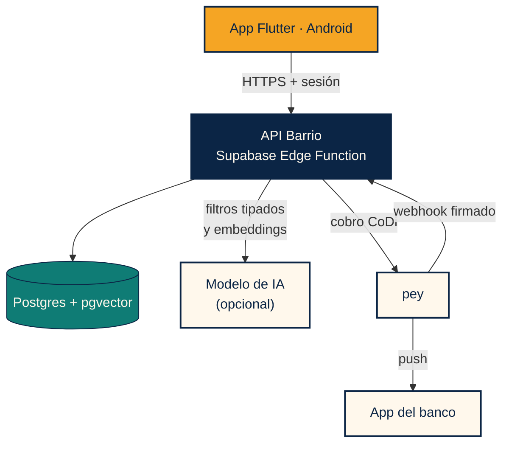
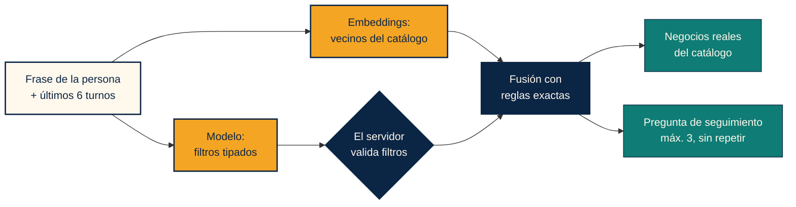
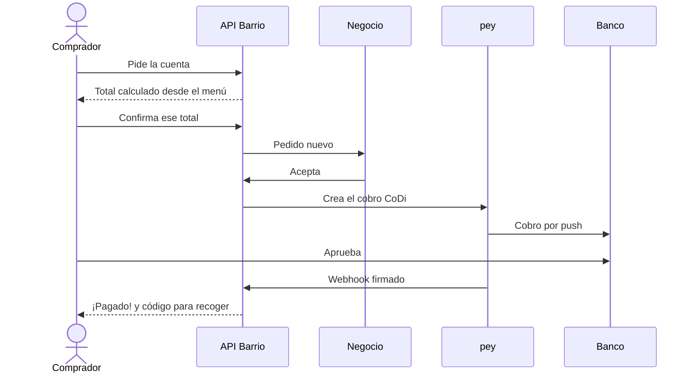
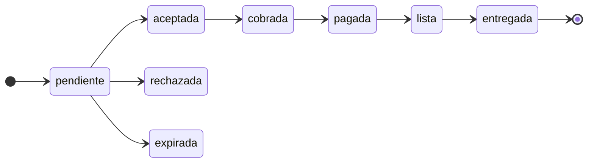

**Español** · [English](ENTREGA.en.md)

# Barrio · Expediente de entrega

**DevDay Exchange Community Hackathon · CDMX · 7–8 de noviembre de 2026**

Búsqueda con IA sobre un catálogo real, totales calculados por el servidor y cobros CoDi reales con pey.

   

---

## Enlaces

| | |
|---|---|
| **Sitio** | https://jade-paprenjak-a98b06.netlify.app |
| **App Android** | [Página de descarga](https://jade-paprenjak-a98b06.netlify.app/descargar/) |
| **Repositorio** | https://github.com/gpancardo/proyectoCoDi |
| **Pitch** | [`PITCH.md`](PITCH.md) |
| **Pantallas** | [Las 23 pantallas de la app](capturas/README.md) |
<!-- | **Video de demo** | ENLACE | -->
<!-- | **Video de pitch** | ENLACE | -->

## Pruébalo en 5 minutos

Necesitas un teléfono Android y un celular con CoDi activo en tu banco.

| Paso | Qué hacer |
|:---:|---|
| 1 | Instala el APK y permite instalar desde esa fuente |
| 2 | Crea una cuenta con tu correo y acepta las notificaciones |
| 3 | Escribe tu celular de 10 dígitos y tu alcaldía |
| 4 | En **Buscar con Barrio**, escribe `algo para una fiesta` y contesta la pregunta |
| 5 | Abre **Tacos Doña Lupe**, agrega el **Taco de prueba** y confirma $0.01 |
| 6 | En unos 5 segundos llega el cobro: apruébalo en tu banco |
| 7 | Mira **¡Pagado!** y tu código para recoger |

> El centavo es dinero real y no se devuelve. Para probar con otra cuenta en el mismo teléfono, borra antes los datos de la app.

## Evidencia del cobro real

| Hora (UTC, 8 nov 2026) | Evento |
|---|---|
| 17:20:08 | Se crea el pedido 21 por un Taco de prueba de $0.01 |
| 17:20:13 | La demo acepta el pedido y pey envía el cobro CoDi por push |
| 17:20:40 | El banco confirma, llega el webhook firmado y el pedido queda `pagada` |

**32 segundos** del pedido al pago, sin intervención manual en el servidor.

<!-- Capturas reales: agrega aquí las imágenes de docs/capturas/reales/

  
  
  

-->

## Qué mirar, según quien evalúa

| Jurado | Qué demostramos | Dónde verlo |
|---|---|---|
| **pey** | CoDi por push de punta a punta, webhook con firma, idempotencia, comprobación de monto y consulta de respaldo | [`pagos.js`](../backend/src/pagos.js) |
| **OpenAI** | Salidas con esquema JSON estricto, embeddings y selección limitada al catálogo recuperado | [`agent.js`](../backend/src/agent.js) |
| **AI Builders** | Búsqueda híbrida, conversación con memoria acotada y respaldo sin modelo | [`search.js`](../backend/src/search.js), [`chat_screen.dart`](../barrio_app_pey/lib/components/sections/chat_screen.dart) |
| **SEDECO** | Una herramienta en español de México para que el comercio local venda en digital | [Pantallas](capturas/README.md), [Sellos](LOGROS.md) |

## Cómo funciona

### Arquitectura

La app no toca tablas ni contiene llaves de servidor.

### Búsqueda: la IA ayuda, el servidor decide

Si no hay modelo disponible, la búsqueda sigue con las reglas exactas. Lo que escribe la persona entra como dato, nunca como instrucción.

### Del pedido al pago

### Estados del pedido

Cada cambio exige el estado anterior, así que un reintento no puede avanzar un pedido dos veces. Las rutas de cancelación y vencimiento del cobro están en [`pedidos.js`](../backend/src/pedidos.js).

## Protecciones

| Riesgo | Protección |
|---|---|
| Precio alterado por la app o por la IA | El total se calcula en el servidor desde el menú vigente |
| Confirmar un total distinto | El pedido exige una cotización vigente y el total que vio la persona |
| Pedido duplicado | Llave de idempotencia y una cotización por pedido |
| Doble cobro | Una restricción en la base permite un solo cobro vigente |
| Webhook falso o repetido | Firma, ventana de tiempo, deduplicación y monto mínimo |
| Webhook perdido | Consulta de respaldo a pey al revisar el cobro |
| Instrucciones escondidas en un mensaje | Las entradas de las personas son datos; el historial va acotado |
| Secretos expuestos | Las llaves viven solo en el servidor; la app no las contiene |

## Calidad

| Comprobación | Resultado |
|---|---|
| Pruebas de backend | 24 en verde: dinero, estados, firma, búsqueda y conversación |
| Pruebas de la app | 8 en verde y análisis estático limpio |
| Esquema | Migraciones y permisos probados en Postgres con pgvector |
| CI | `backend`, `supabase` y `web` en cada PR |
| Recorrido real | Cobro real de $0.01 en producción |

## Real y demo

| Real, en producción | De demo o pendiente |
|---|---|
| API, base de datos y autenticación | Los 14 negocios del catálogo son de demostración |
| Modelo y búsqueda semántica | Los cobros llegan a una cuenta de prueba preautorizada; registrar la cuenta de cada negocio ante Banxico tarda unos 5 días hábiles |
| Cobro CoDi por push y webhook firmado | Doña Lupe acepta sola el Taco de prueba a los 5 s, para probar sin un segundo teléfono |
| Alta de negocios, menú y promociones | Avisos solo mientras Android mantenga viva la app |
| | APK con firma de depuración, fuera de Google Play |
| | Faltan aviso de privacidad, términos, recuperar contraseña, borrar cuenta y límite de uso |

[Pitch](PITCH.md) · [Repositorio](../README.md) · [Producto](PRODUCTO.md) · [API](BACKEND.md)

