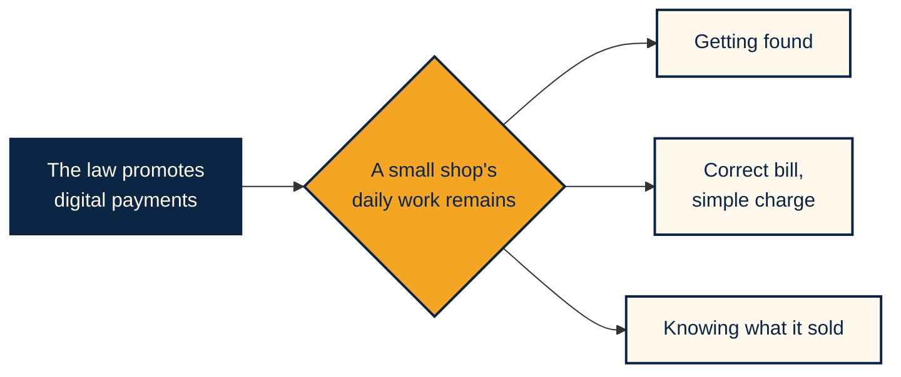

[Español](LEY-ECONOMIA-DIGITAL.md) · **English**

# Why now: Mexico's Digital Economy Law and Barrio

**The law opens the door to digital payments. Barrio is a practical way for the corner shop to walk through it.**

> This document explains the project's context and is not legal advice. It relies on the [decree published in the Official Gazette (DOF)](https://dof.gob.mx/nota_detalle.php?codigo=5803017&fecha=04/11/2026) and the sources listed at the end. English article summaries are our own.

---

## The short version

On November 5, 2026 Mexico's **Ley de Economía Digital para Pagos Digitales y Electrónicos** (Digital Economy Law for Digital and Electronic Payments) came into force. Its purpose is to promote the adoption of digital payment methods nationwide. For sellers, adoption is voluntary, except in sectors the Finance Ministry (SHCP) designates.

A law can promote digital payments, but it does not remove a small shop's work of adding up the bill, sending the charge and confirming it was paid. That is the gap Barrio addresses.

## Timeline

| Date | What happens |
|---|---|
| **June 2026** | Banxico publishes Circular 9/2026 to standardize transfers in mobile apps |
| **November 4** | The law is published in the Official Gazette |
| **November 5** | The law comes into force |
| **Late November** | The 15-business-day deadline for SHCP to designate sectors ends |
| **15 business days later** | Each sector's authorities issue their rules |
| **December 14** | Circular 9/2026 deadline |

## What the law says

| Article | What it establishes |
|---|---|
| **Art. 1** | Promotes adoption and implementation of digital and electronic payment methods, nationwide |
| **Art. 2** | Defines those methods, including QR codes, NFC, cards and transfer orders |
| **Art. 11** | Sellers of goods or services **may** implement them |
| **Art. 12** | When implementing them, sellers enable the infrastructure to receive them and tell customers which ones they accept |
| **Art. 13** | SHCP designates strategic sectors where digital payment may be the only payment method |
| **Art. 14** | Sector authorities may set gradual transitions away from cash |
| **Arts. 15–16** | During a contingency, cash or check is allowed, but not permanently or repeatedly |
| **Art. 17** | Supports the National Financial Inclusion Policy |
| **Art. 19** | Banxico may issue rules to standardize the experience of financial apps |

## What it does not say

- **It does not ban cash in general.**
- **It does not require every shop** to adopt digital methods.
- **It does not name CoDi or DiMo.** We read CoDi as falling under the transfer orders in Art. 2, because a CoDi charge settles as a transfer; this is our interpretation.
- **It does not set fees, tax incentives or its own penalties.**
- **It does not exempt or distinguish** micro and small businesses.
- **It does not yet name sectors.** That is up to SHCP.

## Banxico Circular 9/2026

According to specialized press, the circular requires banks and SPEI participants to standardize SPEI, DiMo, CoDi and QR flows in their mobile apps, with a deadline of **December 14, 2026**. We could not review the official text, so we cite it only as context.

If applied as reported, approving a CoDi charge should feel more consistent from bank to bank, which is exactly the step Barrio depends on.

## How it relates to Barrio

| What the law asks for or promotes | How Barrio helps |
|---|---|
| Enabling infrastructure to receive digital payments (Art. 12, I) | A shop signs up with its phone and collects with CoDi, with no terminal or rent |
| Informing customers which methods are accepted (Art. 12, II) | In Barrio, the payment method is clear before ordering: CoDi from the banking app |
| Handling contingencies (Art. 12, III) | If a charge expires another can be sent, and an order never has two active charges |
| Gradual transition from cash (Art. 14) | A shop can start with in-app orders while continuing to sell as usual |
| Financial inclusion (Art. 17) | The dashboard gives each shop a record of its paid sales |
| Standardized financial apps (Art. 19) | Barrio relies on the approval step inside the banking app |

**Out of scope:** CURP Digital and the Digital Citizen File (Arts. 5–9) concern contracting financial services. Barrio does not use them.

## What Barrio does not claim

- Using Barrio does not amount to complying with any legal obligation.
- Barrio does not replace cash or other methods: it adds a simple way to collect.
- We do not yet know which sectors SHCP will designate or whether neighborhood commerce will be included.
- The sales record is not a credit product, although it may be a first step.

## Sources

| Source | Type | Used for |
|---|---|---|
| [DOF decree, Nov 4, 2026](https://dof.gob.mx/nota_detalle.php?codigo=5803017&fecha=04/11/2026) | Official (Spanish) | Dates, articles and transitional provisions |
| [Basham](https://basham.com.mx/en/se-publica-la-ley-de-economia-digital-para-pagos-digitales-y-electronicos/) | Law firm | Scope, cash and penalties |
| [Santamarina + Steta](https://www.santamarinasteta.mx/en/publicaciones-y-eventos/updates/se-publica-la-ley-de-economia-digital-para-pagos-digitales-y-electronicos/) | Law firm | Context |
| [El Universal](https://www.eluniversal.com.mx/cartera/bancos-deberan-homologar-sus-apps-moviles-para-transferencias-y-pagos-faciles-la-fecha-limite-es-en-diciembre/) | Press | Circular deadline |
| [FintechExpert](https://www.fintechexpert.mx/p/banxico-guia-transferencias-moviles-spei-dimo-codi) | Specialized press | Circular scope |
| [Banxico: CoDi](https://www.banxico.org.mx/sistemas-de-pago/codi-cobro-digital-banco-me.html) | Official | What CoDi is and what it costs |

[Pitch](PITCH.en.md) · [Submission dossier](ENTREGA.en.md) · [Repository](../README.en.md)

