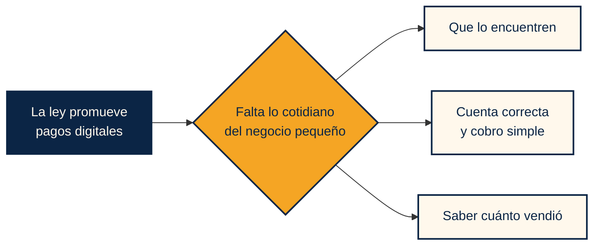

**Español** · [English](LEY-ECONOMIA-DIGITAL.en.md)

# Por qué ahora: la Ley de Economía Digital y Barrio

**La ley abre la puerta a los pagos digitales. Barrio es una forma práctica de que la tiendita de la esquina pueda cruzarla.**

> Este documento explica el contexto del proyecto y no es asesoría legal. Se apoya en el [decreto publicado en el DOF](https://dof.gob.mx/nota_detalle.php?codigo=5803017&fecha=04/11/2026) y en las fuentes listadas al final.

---

## La idea en corto

El 5 de noviembre de 2026 entró en vigor la **Ley de Economía Digital para Pagos Digitales y Electrónicos**. Su objeto es promover la adopción de medios de pago digitales en todo el país. Para quien vende, adoptarlos es voluntario, salvo en los sectores que determine Hacienda.

Una ley puede promover un pago digital, pero no le quita a un negocio pequeño el trabajo de armar la cuenta, mandar el cobro y confirmar que le pagaron. Ese es el hueco que atiende Barrio.

## Calendario

| Fecha | Qué pasa |
|---|---|
| **Junio de 2026** | Banxico publica la Circular 9/2026 para homologar transferencias en apps móviles |
| **4 de noviembre** | La ley se publica en el Diario Oficial |
| **5 de noviembre** | La ley entra en vigor |
| **Fines de noviembre** | Vencen los 15 días hábiles para que Hacienda determine sectores |
| **15 días hábiles después** | Las autoridades de cada sector emiten sus disposiciones |
| **14 de diciembre** | Fecha límite de la Circular 9/2026 |

## Qué dice la ley

| Artículo | Qué establece |
|---|---|
| **Art. 1** | Promover la adopción e implementación de medios de pago digitales y electrónicos, con observancia en todo el país |
| **Art. 2** | Define esos medios, entre ellos códigos QR, NFC, tarjetas y órdenes de transferencia |
| **Art. 11** | Quienes venden bienes o servicios **podrán** implementarlos |
| **Art. 12** | Al implementarlos, habilitan la infraestructura para recibirlos e informan a sus clientes cuáles aceptan |
| **Art. 13** | Hacienda determina sectores estratégicos donde el pago digital podrá ser la única forma de pago |
| **Art. 14** | Las autoridades de cada sector pueden fijar transiciones graduales desde el efectivo |
| **Arts. 15 y 16** | En una contingencia se permite efectivo o cheque, pero no de forma permanente o recurrente |
| **Art. 17** | Coadyuva con la Política Nacional de Inclusión Financiera |
| **Art. 19** | Banxico podrá emitir disposiciones para homologar la experiencia de las apps financieras |

## Qué no dice

- **No prohíbe el efectivo en general.**
- **No obliga a todos los comercios** a adoptar medios digitales.
- **No nombra a CoDi ni a DiMo.** Leemos a CoDi dentro de las órdenes de transferencia del Art. 2, porque un cobro CoDi se liquida como transferencia; es nuestra interpretación.
- **No define comisiones, incentivos fiscales ni sanciones propias.**
- **No exenta ni distingue** a micro y pequeños negocios.
- **Todavía no nombra sectores.** Eso le toca a Hacienda.

## La Circular 9/2026 de Banxico

Según la prensa especializada, la circular obliga a bancos y participantes del SPEI a homologar en sus apps móviles los flujos de SPEI, DiMo, CoDi y QR, con fecha límite del **14 de diciembre de 2026**. No pudimos consultar el texto oficial, así que lo citamos solo como contexto.

Si se aplica como se ha reportado, aprobar un cobro CoDi debería sentirse más parecido de un banco a otro, justo el paso del que depende Barrio.

## Cómo se relaciona con Barrio

| Lo que pide o promueve la ley | Cómo ayuda Barrio |
|---|---|
| Habilitar la infraestructura para recibir pagos digitales (Art. 12, I) | Un negocio se registra con su celular y cobra con CoDi, sin terminal ni renta |
| Informar qué medios se aceptan (Art. 12, II) | En Barrio, la forma de pago es clara desde antes de pedir: CoDi desde la app del banco |
| Atender contingencias (Art. 12, III) | Si un cobro vence, se puede mandar otro, y nunca hay dos vigentes para un pedido |
| Transición gradual desde el efectivo (Art. 14) | Un negocio puede empezar con pedidos en la app sin dejar de vender como siempre |
| Inclusión financiera (Art. 17) | El panel da a cada negocio un registro de sus ventas pagadas |
| Homologación de apps financieras (Art. 19) | Barrio se apoya en el paso de aprobación dentro de la app del banco |

**Fuera de alcance:** la CURP Digital y el Expediente Digital Ciudadano (Arts. 5 a 9) tratan de contratar servicios financieros. Barrio no los usa.

## Lo que Barrio no afirma

- Usar Barrio no equivale a cumplir ninguna obligación legal.
- Barrio no sustituye al efectivo ni a otros medios: agrega una forma sencilla de cobrar.
- No sabemos aún qué sectores determinará Hacienda ni si incluirán comercio de barrio.
- El registro de ventas no es un producto de crédito, aunque puede ser un primer paso.

## Fuentes

| Fuente | Tipo | Para qué se usó |
|---|---|---|
| [Decreto en el DOF, 4 nov 2026](https://dof.gob.mx/nota_detalle.php?codigo=5803017&fecha=04/11/2026) | Oficial | Fechas, artículos y transitorios |
| [Basham](https://basham.com.mx/en/se-publica-la-ley-de-economia-digital-para-pagos-digitales-y-electronicos/) | Despacho legal | Alcance, efectivo y sanciones |
| [Santamarina + Steta](https://www.santamarinasteta.mx/en/publicaciones-y-eventos/updates/se-publica-la-ley-de-economia-digital-para-pagos-digitales-y-electronicos/) | Despacho legal | Contexto |
| [El Universal](https://www.eluniversal.com.mx/cartera/bancos-deberan-homologar-sus-apps-moviles-para-transferencias-y-pagos-faciles-la-fecha-limite-es-en-diciembre/) | Prensa | Plazo de la circular |
| [FintechExpert](https://www.fintechexpert.mx/p/banxico-guia-transferencias-moviles-spei-dimo-codi) | Prensa especializada | Alcance de la circular |
| [Banxico: CoDi](https://www.banxico.org.mx/sistemas-de-pago/codi-cobro-digital-banco-me.html) | Oficial | Qué es CoDi y su costo |

[Pitch](PITCH.md) · [Expediente de entrega](ENTREGA.md) · [Repositorio](../README.md)

