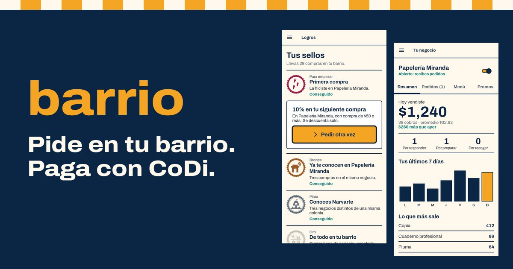
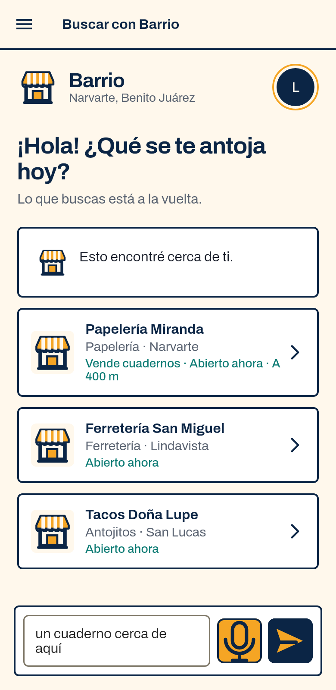
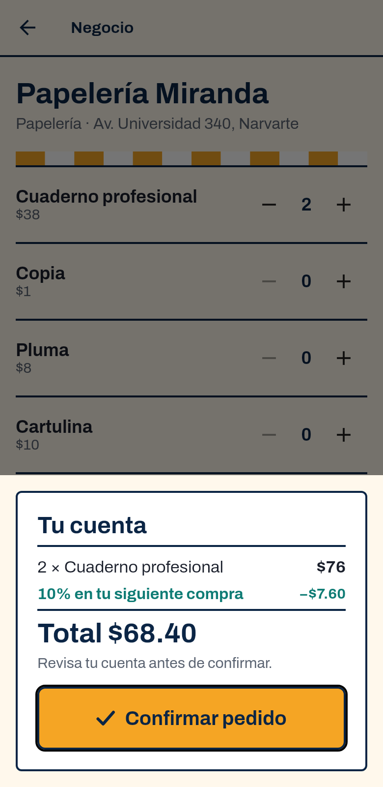
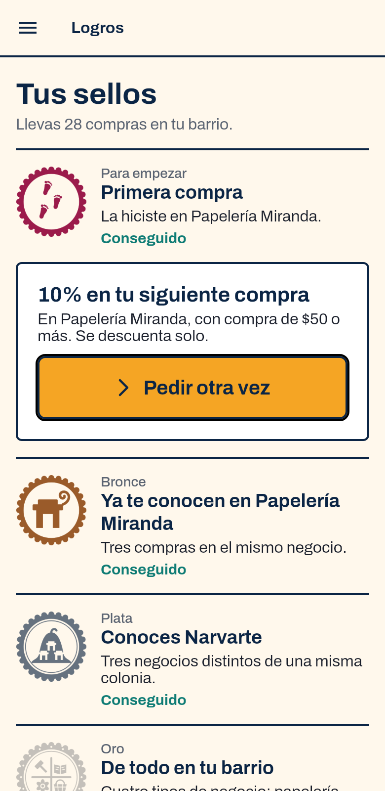
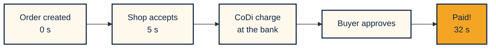
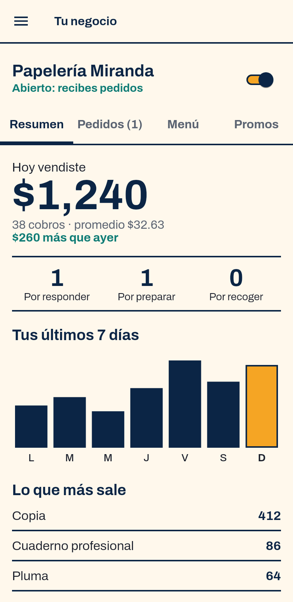
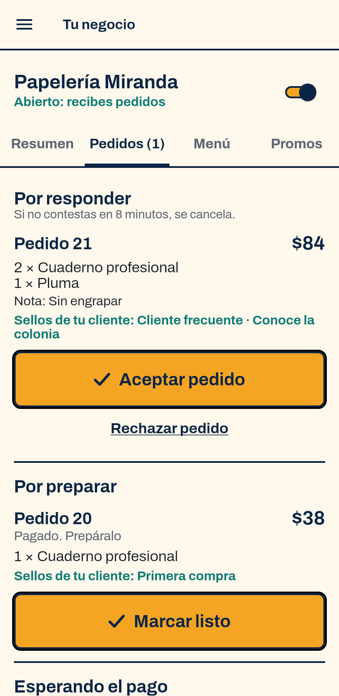

[Español](PITCH.md) · **English**

# The best of the neighborhood, one tap away

**Barrio makes buying from a shop in your neighborhood and paying with CoDi as easy as ordering at the corner.**

| 32 s | $0 | 16 |
|:---:|:---:|:---:|
| from order to payment, on a real charge | fee to collect with CoDi | Mexico City boroughs with their own badge |

> Barrio is a Spanish-language app built for Mexico City, so the screenshots are in Spanish. **CoDi** is Banco de México's digital collection system: a payment request reaches your banking app and you approve it there.

---

## The problem

Neighborhood shops face two disadvantages that feed each other:

- **Nobody finds them beyond their own block.** Orders arrive by text message and totals are worked out by hand.
- **Going digital costs them money.** A card terminal charges per sale and sometimes a monthly rent. As an example, 3.5% on MX$15,000 a month is **MX$525 a month, MX$6,300 a year**.

CoDi already solves the money part: it [generates no additional fees and settles in seconds](https://www.banxico.org.mx/sistemas-de-pago/codi-cobro-digital-banco-me.html). What is missing is everything before and after the charge. Today, ordering and collecting with CoDi takes more effort than handing over a banknote.

## The idea

Barrio brings together the three things CoDi does not do on its own.

<table>
<tr>
<th width="33%">1. Get found</th>
<th width="33%">2. Collect simply</th>
<th width="33%">3. Bring customers back</th>
</tr>
<tr>
<td align="center"></td>
<td align="center"></td>
<td align="center"></td>
</tr>
<tr>
<td>Search in your own words or by voice. Barrio understands the request and asks for what is missing.</td>
<td>The total comes from the shop's menu. Once accepted, the charge goes straight to the banking app.</td>
<td>Promotions for past customers, and badges for buying in your neighborhood and across the city.</td>
</tr>
</table>

## It already works with real money

On November 8, 2026 we ran the whole journey in production: a real order, a MX$0.01 CoDi charge approved in the banking app, and the order marked as paid by pey's signed webhook.

## For the shop owner

<table>
<tr>
<td width="30%" align="center"></td>
<td width="30%" align="center"></td>
<td>

**No terminal, no rent, no hand-written totals.**

- Registers the shop and its menu in the app, with no manual review.
- Accepts or rejects with one tap, or turns on automatic acceptance.
- Sees what it sold, what sells most and how many customers return.
- Publishes promotions that apply themselves.

For many shops, this will be the first time they have these numbers.

</td>
</tr>
</table>

## Badges of your city

Buying locally leaves a mark: one badge for each of the 16 boroughs, in bronze, silver and gold.

     

## Why it can be trusted

| | |
|---|---|
| **AI never sets prices** | It interprets the request. Prices, availability and totals come from the server. |
| **It cannot invent shops** | It can only choose among results retrieved from the catalog. |
| **If the model fails, search continues** | It falls back to exact rules on text, area, category and price. |
| **One order, one charge** | Only one charge can be active, and every status change requires the previous status. |
| **Barrio stays out of your bank** | You approve in your own banking app. We never see or store your credentials. |

## Impact and model

- **For shops:** sell beyond the block, collect with CoDi at no fee and start building a sales record.
- **For the city:** a tool in Mexican Spanish, designed for Android phones and short steps.
- **For the CoDi ecosystem:** every active shop is real usage of a network that already exists.
- **Model:** collecting with CoDi carries no fee. In the future, a low-cost plan for extras such as reports, multiple staff or delivery.

## What comes next

| Now | Next | Later |
|---|---|---|
| Real ordering and payment on Android | Each shop's own bank account | Pilot in a first neighborhood |
| 14 demo shops | Privacy notice and terms | Google Play release |
| Alerts while the app is alive | Notifications with the app closed | Barrio Mostrador: charge in store by dictating the order |

> **Current status.** Shops are demo data, and demo charges go to a pre-authorized test account set up for the hackathon. Details are in the [submission dossier](ENTREGA.en.md#real-and-demo).

[Submission dossier](ENTREGA.en.md) · [Repository](../README.en.md) · [All screens](capturas/README.md)

