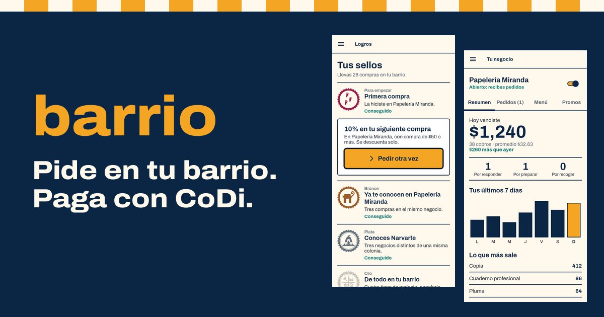
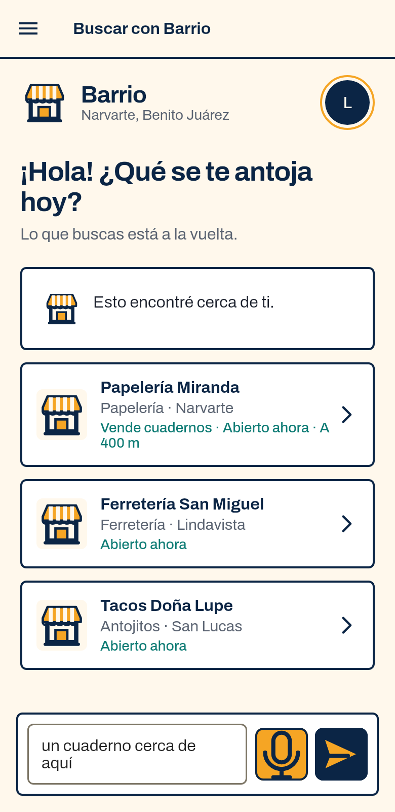
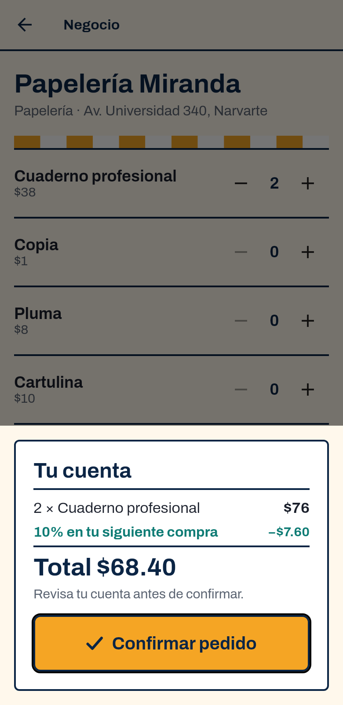
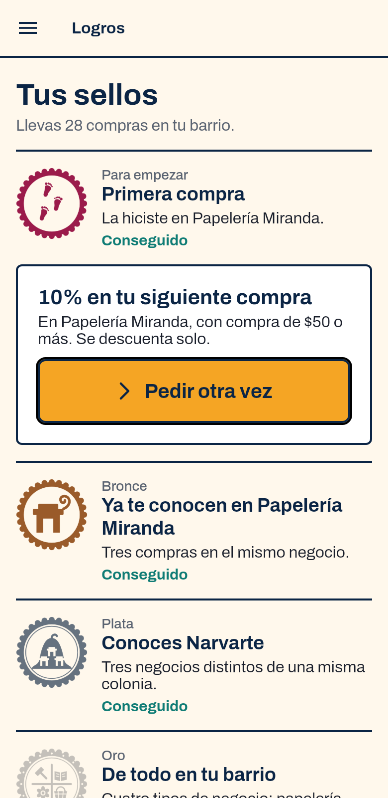
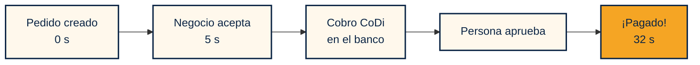
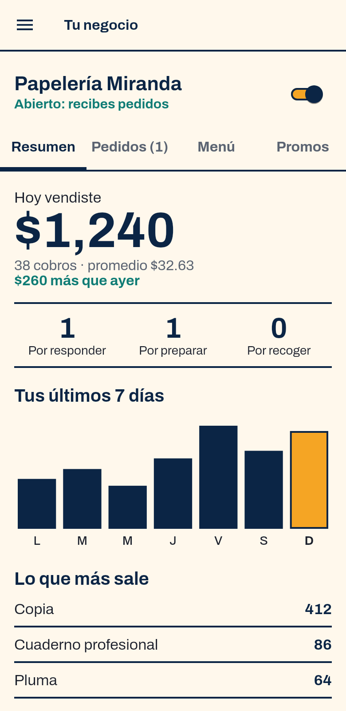
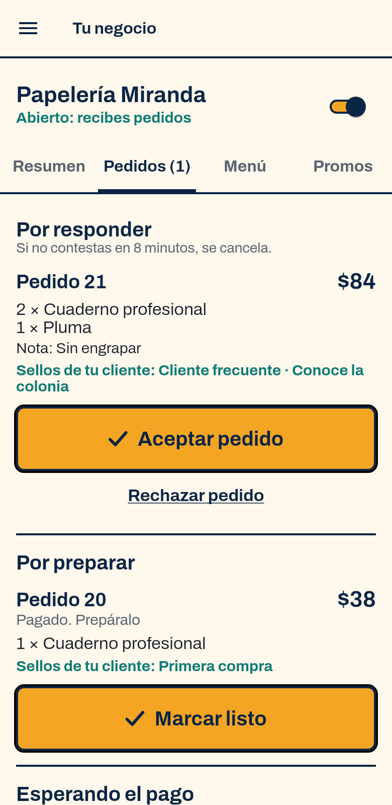

**Español** · [English](PITCH.en.md)

# Lo bueno del barrio, a un toque

**Barrio hace que comprarle a un negocio de tu colonia y pagarle con CoDi sea tan fácil como pedir en la esquina.**

| 32 s | $0 | 16 |
|:---:|:---:|:---:|
| del pedido al pago, en un cobro real | de comisión al cobrar con CoDi | alcaldías con sello propio |

---

## El problema

El comercio de barrio tiene dos desventajas que se refuerzan entre sí:

- **Nadie lo encuentra fuera de su cuadra.** Los pedidos llegan por mensaje y la cuenta se hace a mano.
- **Cobrar en digital le cuesta.** Una terminal cobra por venta y a veces renta. Como ejemplo, con 3.5% sobre $15,000 al mes se van **$525 al mes, $6,300 al año**.

CoDi, el sistema de cobros de Banco de México, ya resuelve el dinero: [no genera comisiones adicionales y opera en segundos](https://www.banxico.org.mx/sistemas-de-pago/codi-cobro-digital-banco-me.html). Lo que le falta es todo lo que pasa antes y después del cobro. Hoy pedir y cobrar con CoDi da más trabajo que dar un billete.

## Por qué ahora

El 5 de noviembre de 2026 entró en vigor la **Ley de Economía Digital para Pagos Digitales y Electrónicos**, que promueve la adopción de pagos digitales en todo el país. Hay una ley nueva y CoDi ya existe; falta lo cotidiano para que un negocio pequeño los use. [Cómo se relaciona con Barrio](LEY-ECONOMIA-DIGITAL.md).

## La idea

Barrio junta las tres cosas que CoDi no hace por sí solo.

<table>
<tr>
<th width="33%">1. Que te encuentren</th>
<th width="33%">2. Cobrar simple</th>
<th width="33%">3. Que te vuelvan a comprar</th>
</tr>
<tr>
<td align="center"></td>
<td align="center"></td>
<td align="center"></td>
</tr>
<tr>
<td>Buscas con tus palabras o dictando. Barrio entiende lo que pides y te pregunta lo que falta.</td>
<td>El total sale del menú del negocio. Al aceptar, el cobro llega solo a la app del banco.</td>
<td>Promociones para quien ya compró y sellos por comprar en tu colonia y en tu ciudad.</td>
</tr>
</table>

## Ya funciona con dinero real

El 8 de noviembre de 2026 hicimos el recorrido completo en producción: un pedido real, un cobro CoDi de $0.01 aprobado en la app del banco y el pedido marcado como pagado por el webhook firmado de pey.

## Para el negocio

<table>
<tr>
<td width="30%" align="center"></td>
<td width="30%" align="center"></td>
<td>

**Sin terminal, sin renta y sin cuenta a mano.**

- Registra su negocio y su menú desde la app, sin trámite manual.
- Acepta o rechaza con un toque, o activa la aceptación automática.
- Ve cuánto vendió, lo que más sale y cuántos clientes regresan.
- Publica promociones que se descuentan solas.

Para muchos negocios, será la primera vez que tengan estos números.

</td>
</tr>
</table>

## Sellos de tu ciudad

Comprar en tu barrio deja huella: un sello por cada una de las 16 alcaldías, en bronce, plata y oro.

     

## Por qué se puede confiar

| | |
|---|---|
| **La IA nunca pone precios** | Interpreta lo que pides. Precios, disponibilidad y totales salen del servidor. |
| **No inventa negocios** | Solo puede elegir entre resultados recuperados del catálogo. |
| **Si el modelo falla, sigue** | La búsqueda cae a reglas exactas por texto, zona, categoría y precio. |
| **Un pedido, un cobro** | Solo puede haber un cobro vigente y cada cambio de estado exige el anterior. |
| **Barrio no toca tu banco** | Apruebas en la app de tu banco. No vemos ni guardamos tus credenciales. |

## Impacto y modelo

- **Para el comercio:** vende más allá de su cuadra, cobra sin comisión con CoDi y empieza a tener registro de ventas.
- **Para la ciudad:** una herramienta en español de México, pensada para celulares Android y para pasos cortos.
- **Para el ecosistema CoDi:** cada negocio activo es uso real para una red que ya existe.
- **Modelo:** cobrar con CoDi no tiene comisión. A futuro, un plan de bajo costo para funciones extra, como reportes, varios empleados o envíos.

## Lo que sigue

| Ahora | Siguiente | Después |
|---|---|---|
| Compra y cobro real en Android | Cuenta bancaria propia por negocio | Piloto en una primera colonia |
| 14 negocios de demostración | Aviso de privacidad y términos | Publicación en Google Play |
| Avisos mientras la app sigue viva | Notificaciones con la app cerrada | Barrio Mostrador: cobrar en el local dictando el pedido |

> **Estado actual.** Los negocios son de demostración y los cobros de la demo llegan a una cuenta de prueba preautorizada para el hackathon. El detalle está en el [expediente de entrega](ENTREGA.md#real-y-demo).

[Expediente de entrega](ENTREGA.md) · [Por qué ahora](LEY-ECONOMIA-DIGITAL.md) · [Repositorio](../README.md) · [Todas las pantallas](capturas/README.md)

